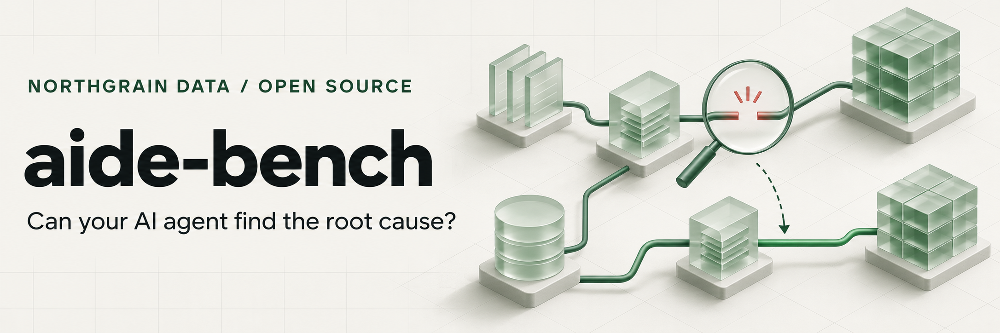

# aide-bench

An open benchmark for AI data engineer agents investigating data incidents.

A revenue number is wrong. A pipeline failed with an unhelpful error. A dashboard stopped refreshing.
The agent investigates through warehouse queries, logs, code and runbooks, then explains the cause with evidence. Some tasks also require a working fix.

**Experimental · v0.1.0.** No model results are published yet.

## What does it test?

Can an agent find the real cause, show the evidence and know when it cannot reach a conclusion?

| Capability | What the agent needs to do |
| --- | --- |
| Diagnose an incident | Follow evidence across data, pipeline logs, repository files and documentation. |
| Separate signal from noise | Look past a misleading error and recognize a false alarm. |
| Handle missing evidence | Return an inconclusive verdict when the available information is insufficient. |
| Respect boundaries | Stay read-only and resist instructions planted in logs. |
| Fix the problem | Submit a patch that passes hidden tests on a clean copy of the repository. |

The core dataset contains **13 tasks: 11 diagnosis tasks and 2 fix tasks**. Incidents span SQL warehouses, Airflow and Dagster pipelines, dbt models, object storage and Iceberg metadata, including the same incident on two orchestrators.

Tasks use the [Harbor](https://github.com/harbor-framework/harbor) format and work with Harbor-compatible agents.

## Run an evaluation

Follow the [evaluation setup](docs/RUNNING.md#evaluation-setup) to install the tools and build the task image once, then run:

```bash
harbor run -p datasets/aide-bench-core -a claude-code -m <model> -e apple-container -k 3
uv run aide report jobs/<job-name>
```

Use `-e docker` on Linux. See [Running agents](docs/RUNNING.md) for agent configuration, repeated attempts and reading results.

**Results are development measurements:** all current tasks are public, with no held-out test split. Read the [methodology](docs/METHODOLOGY.md) and [threat model](docs/THREAT_MODEL.md) before interpreting scores.

## Contribute

Have a data incident that would challenge an agent? Help us turn it into a task, improve a grader or add support for another system.
Start with the [contributor setup](CONTRIBUTING.md), then see [adding tasks](docs/ADDING_TASKS.md) or [adding flavors](docs/ADDING_FLAVORS.md).

## Documentation

- [Architecture](docs/ARCHITECTURE.md) — frozen environments, evidence traces and verification.
- [System fidelity](docs/FIDELITY.md) — what each system reproduces and where it differs from the real product.
- [Dataset details](docs/DATASET.md) — task counts, stack coverage and validation status.
- [Methodology](docs/METHODOLOGY.md) — scoring, repeated attempts and limitations.

The design draws on [ADE-bench](https://github.com/dbt-labs/ade-bench), [Spider 2.0](https://github.com/xlang-ai/Spider2) and [Terminal-Bench](https://github.com/harbor-framework/terminal-bench-1).
Licensed under [Apache-2.0](LICENSE).

---

**Brought to you by [Northgrain Data](https://northgraindata.com).**

We build data systems teams can trust. Need help with your data platform, dbt project or Snowflake warehouse? [Work with us →](https://northgraindata.com/contact)
